Every algorithm below is in our code. Each has: **what it does** (plain words), **pseudo code**, a **flow diagram**, and **where it lives** (file in `src/paperlens/`). Pseudo code is simplified from the real code; names are shortened.

**Index of algorithms**

| # | Algorithm | Engine | File |
|---|---|---|---|
| 1 | Diary append, group commit, torn-tail scan | E2 | `store/diary.py` |
| 2 | Flush with atomic MANIFEST swap | E2 | `store/index.py`, `segment.py`, `manifest.py` |
| 3 | Crash recovery on open | E2 | `store/index.py` |
| 4 | Gap + variable-byte postings compression | E3 | `text/varint.py` |
| 5 | Tokenizer | E3 | `text/tokenizer.py` |
| 6 | BM25 ranking | E3 | `store/segment.py`, `native.py` |
| 7 | Compaction (size-tiered merge) | E2 | `store/compaction.py`, `index.py` |
| 8 | Reader pins (safe deletion) | E2 | `store/pins.py` |
| 9 | Pipeline scheduling, job states, failure handling | E1 | `pipeline/supervisor.py` |
| 10 | Shared-memory vector hand-off with CRC | E1 | `pipeline/shm.py`, `workers.py` |
| 11 | Request limiter (reserve, then sleep) | E1 | `harvest/limiter.py`, `pipeline/shared_limiter.py` |
| 12 | 1-4 bit vector quantization (RaBitQ-style) and re-scoring | E3 | `vectors/quant.py` |
| 13 | IVF clustering with k-means | E3 | `vectors/ivf.py` |
| 14 | Reciprocal Rank Fusion and the hybrid query | E3 | `vectors/fusion.py`, `store/index.py` |
| 15 | PageRank and personalized PageRank | E3 | `graph/rank.py` |
| 16 | Label propagation | E3 | `graph/rank.py` |
| 17 | Citation-aware reranking | E3 | `graph/rerank.py` |
| 18 | MinHash + LSH near-duplicate detection | E3 | `graph/minhash.py` |
| 19 | Late-interaction MaxSim rerank (stand-in encoder) | E3 | `vectors/late.py` |
| 20 | Evaluation metrics: nDCG, Recall, MRR | E3 | `eval/metrics.py` |

# Part A. Storage and durability (E2)

## 1. Diary append, group commit, torn-tail scan

**What it does:** every change is first appended to a log file. A record is `[length][crc32][payload]`. A paper counts as safe only after `fsync`. If the machine dies mid-write, the end of the file can be half-written; the scan finds the first bad record and cuts the file there.

```text
put(paper):
    entry = JSON{seq+1, "put", key, paper}
    frame = u32(len(entry)) + u32(crc32(entry)) + entry
    append frame to the diary file            # in the OS cache only, not yet safe

commit():
    fsync(diary file)                         # one fsync for the whole batch = "group commit"
    -> everything put so far is now ACKNOWLEDGED

scan(diary file):                             # used by recovery
    pos = 0
    while pos < file_size:
        if fewer than 8 bytes left: stop
        len, crc = read header
        if len > 64 MiB or pos+8+len > file_size: stop      # absurd or short record
        payload = read len bytes
        if crc32(payload) != crc: stop                      # damaged record
        yield payload
        pos += 8 + len
    cut file at pos; fsync                    # drop the torn tail
```

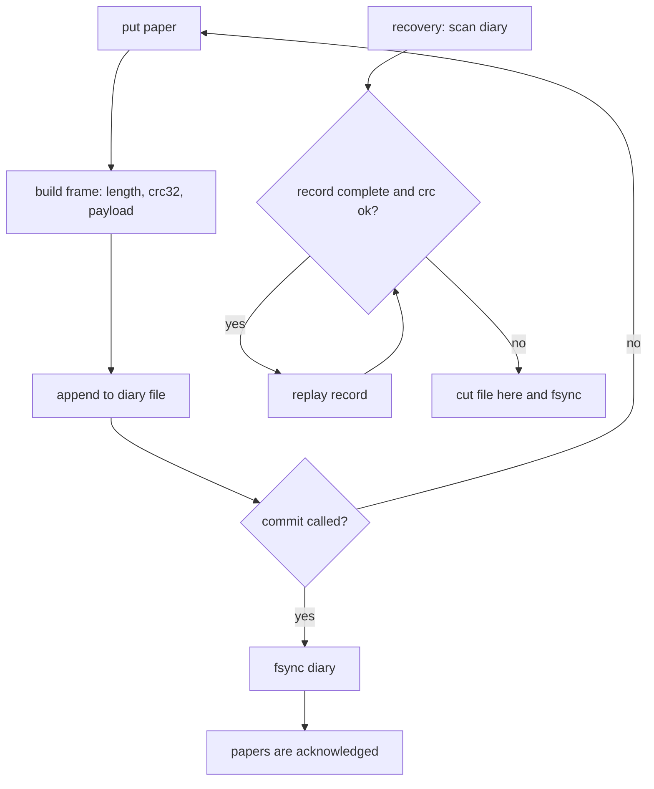

## 2. Flush with an atomic MANIFEST swap

**What it does:** turns the in-memory buffer into an immutable segment folder, then switches the index to include it in one atomic step. Every step is a named crash point we kill the program at in tests.

```text
flush():
    fsync diary                                # nothing unlogged may be flushed
    name = next segment name  (seg-N)
    write all segment files into segments/.tmp-seg-N/   # postings, terms, docs, vectors, meta (meta last)
    fsync every file and the folder
    CRASHPOINT flush_after_tmp_written
    rename .tmp-seg-N  ->  seg-N ; fsync parent folder
    CRASHPOINT flush_after_segment_rename
    write MANIFEST.tmp {generation+1, last_flushed_seq, segments + [seg-N], crc}
    fsync MANIFEST.tmp ; rename over MANIFEST ; fsync folder      # the atomic switch
    CRASHPOINT flush_after_manifest
    start a new diary file
    delete the old diary files
    CRASHPOINT flush_after_wal_delete
```

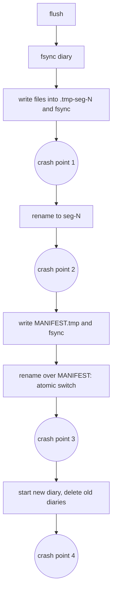

**Why it is safe:** a crash before the MANIFEST rename leaves the old list (the new folder is just junk that recovery deletes); a crash after it leaves the new list. There is no in-between state.

## 3. Crash recovery on open

```text
open(index):
    manifest = read MANIFEST and verify its crc          # error if damaged
    delete MANIFEST.tmp if present
    for folder in segments/:
        if folder starts with ".tmp-":                   delete it
        else if folder not listed in manifest and no reader pins it: delete it
    open every listed segment and check it
    load the citation graph listed in the manifest (if any)
    seq = manifest.last_flushed_seq
    for record in scan(diary files):                     # algorithm 1
        if record.seq > seq: apply it to the buffer ; seq = record.seq
    cut the torn tail ; fsync
```

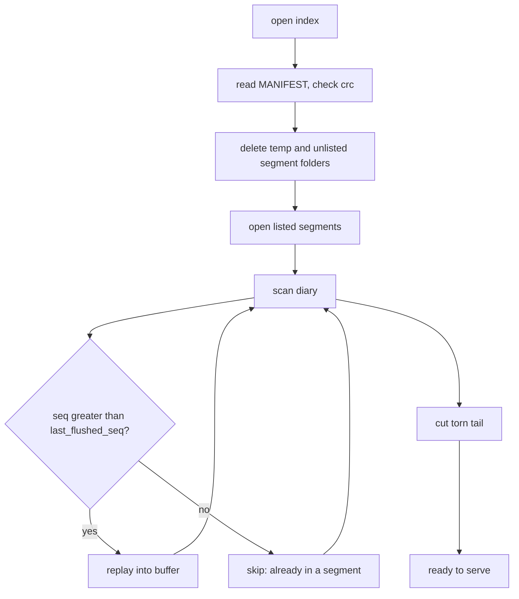

## 4. Gap + variable-byte postings compression

**What it does:** a postings list says "word X is in documents 3, 7, 8, 20". We store the gaps (3, 4, 1, 12) because small numbers need fewer bytes, then write each number as a varint: 7 bits per byte, the top bit says "more bytes follow".

```text
encode_varint(n):
    while n >= 128:
        output (n mod 128) + 128 ;  n = n div 128
    output n

encode_postings(pairs of (doc, tf)):
    prev = -1
    for (doc, tf) in pairs:           # doc strictly increasing
        output varint(doc - prev) ; output varint(tf)
        prev = doc

decode: read varints, add each gap to the previous doc id
```

Example: documents 3, 7, 8, 20 with tf 2, 1, 1, 3 become gaps 4, 4, 1, 12 (first gap counts from -1), each pair taking 2 bytes, 8 bytes in total, instead of 32 bytes with fixed 4-byte numbers.

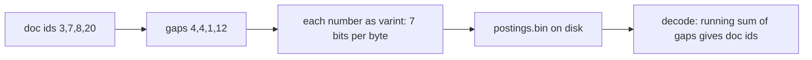

## 5. Tokenizer

**What it does:** turns text into search terms. Lowercases, splits on punctuation, drops common stop words, and keeps science-style compounds both whole and in parts.

```text
tokenize(text):
    words = lowercase(text) split into alphanumeric chunks, keeping hyphen joins
    for each chunk:
        output the chunk                         # "crash-safe", "gpt-4", "bm25"
        if it has a hyphen: also output each part # "crash", "safe", "gpt"
    remove stop words ("a", "and", "the", "of", "for", ...)
```

Real output from our code for `crash-safe write-ahead log for BM25 and GPT-4`: crash-safe, crash, safe, write-ahead, write, ahead, log, bm25, gpt-4, gpt. No stemming, so "logging" and "log" are different terms.

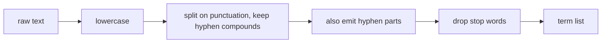

## 6. BM25 ranking

**What it does:** scores each document for a query. A word matters more if it is rare (idf), if it appears often in the document (tf, with diminishing returns), and if the document is short.

```text
N = live documents ; avgdl = average document length ; k1 = 1.2 ; b = 0.75
idf(term) = ln(1 + (N - df + 0.5) / (df + 0.5))         # df = documents containing the term

score(doc) = sum over query terms t in doc:
    idf(t) * tf * (k1 + 1) / ( tf + k1 * (1 - b + b * doclen / avgdl) )

search(query):
    scores = array of 0 per document
    for t in tokenize(query):
        for each segment and the buffer:
            for (doc, tf) in postings(t) not deleted and passing filters:
                scores[doc] += idf(t) * tf * (k1+1) / (tf + k1*(1 - b + b*doclen[doc]/avgdl))
    return top k by score
```

Statistics N, df and avgdl include deleted documents until compaction (same as Lucene). Our result equals a brute-force reimplementation to 1e-9 in the tests; the C++ version gives identical results to the Python version.

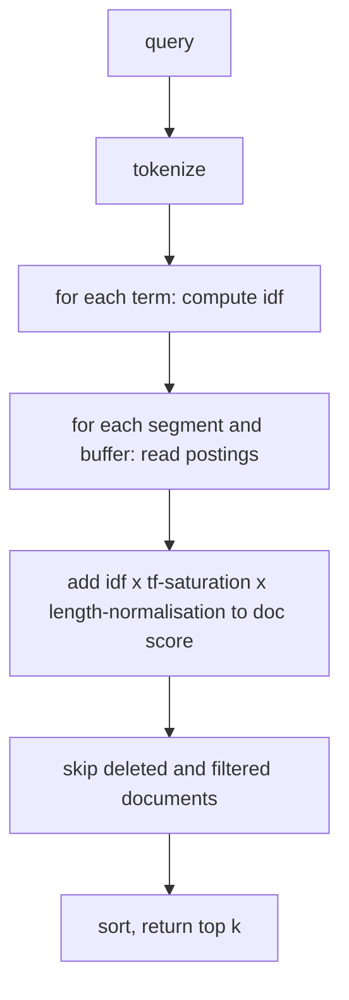

## 7. Compaction (size-tiered merge)

**What it does:** every flush adds a segment and queries must read all of them. Compaction rewrites several small neighbouring segments as one, dropping deleted papers for good.

```text
plan_run(sizes, dead_counts, fan_in = 4, ratio = 4, dead_ratio = 0.5):
    for i in 0 .. n - fan_in:
        window = sizes[i .. i+fan_in-1]
        if max(window) <= ratio * min(window): return (i, i+fan_in-1)   # similar sizes
    for i in segments:
        if dead_counts[i] / sizes[i] >= dead_ratio: return (i, i)      # mostly dead: rewrite
    return nothing

merge_run(segments, dead sets, older_keys):
    docs = every live document of the run, with its text counts and half-precision vector
    tombstones = union of the run's tombstones, kept only if the key exists in OLDER segments
    write new segment .tmp -> fsync -> rename -> MANIFEST swap -> delete old folders (if not pinned)
```

Only neighbours are merged because a segment's tombstones apply to the segments before it.

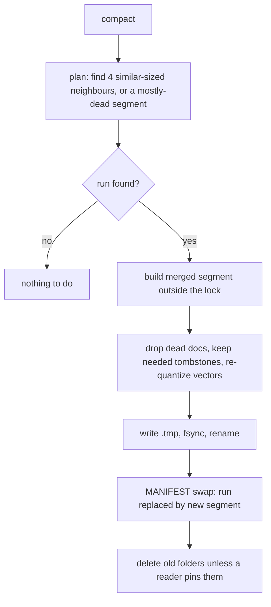

## 8. Reader pins (safe deletion)

**What it does:** a query process must not have its files deleted by compaction. Each reader writes a pin file listing the segments it uses and holds an OS lock on it; if the reader dies, the OS drops the lock.

```text
reader.open():
    create pins/pin-<pid>-<random>.json and take an OS lock on it
    write the list of segments it uses
    re-read the MANIFEST to confirm; if it changed meanwhile: update the pin and retry
      # (the pin is written BEFORE confirming, so the writer cannot miss it)

writer after publishing a new MANIFEST:
    for each obsolete segment folder:
        if no LIVE pin lists it: delete it     # a pin whose lock can be taken belongs to a dead reader: remove it
```

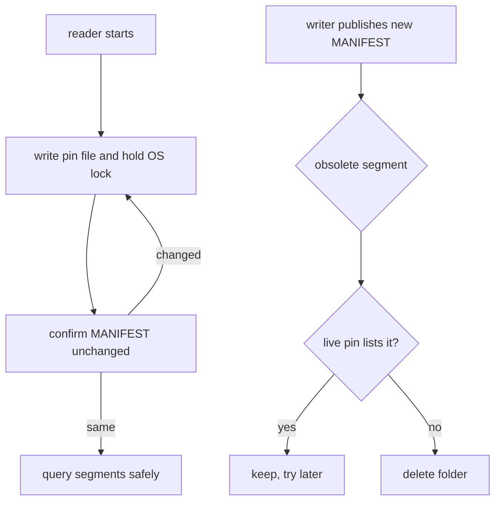

# Part B. Multi-process pipeline (E1)

## 9. Scheduling, job states and failure handling

**What it does:** the supervisor hands papers to reader processes, forwards results to the single writer, and remembers every paper until the writer says it is durable. Nothing is forgotten, so a crash can only cause a re-send, never a loss. A duplicate re-send is ignored by the writer (same key), so every paper is stored exactly once.

```text
supervisor loop:
    while papers remain or jobs are unfinished:
        refill: for each paper while the least-loaded reader has fewer than LIMIT jobs:
            pick the least-loaded reader ; choose a shared-memory slot ; send PaperJob
            job.state = in_reader
        receive messages:
            PaperReady from reader: forward to the writer ; job.state = in_writer
            Ack(seq >= 1 stored, or -1 duplicate) from writer: job.state = done ; free slot
            Ack(-2 rejected, bad vector) : attempts += 1 ; back to pending
        health check: is_alive and heartbeats
            reader dead or hung: kill, respawn, re-queue its jobs ; blame only the head job (attempts += 1)
            writer dead: respawn (it recovers from its diary) ; re-send every job in_writer
        if a job's attempts >= max: move it to the dead-letter list
        if respawns exceed the limit: stop with a clear error
writer: take up to 64 messages, check each vector crc, put() each, ONE commit(), then Ack all
```

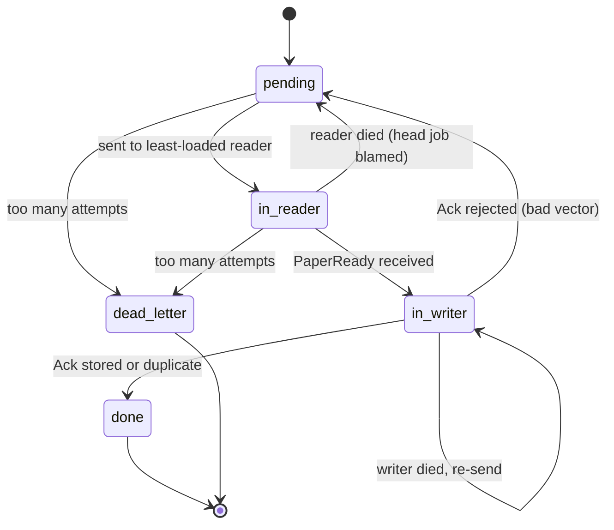

## 10. Shared-memory vector hand-off with CRC

**What it does:** vectors are too big to send through a pipe for every paper, so each reader owns a shared-memory arena of slots. The supervisor chooses the slot; the message carries only the slot number and a checksum.

```text
reader: vector = embed(paper) ; write the bytes into arena[slot] ; send PaperReady(slot, crc32(bytes), ...)
writer: copy bytes out of arena[slot] ; if crc32(copy) != crc: Ack(-2)   # stale or torn slot: retry
        else store the paper with this vector
```

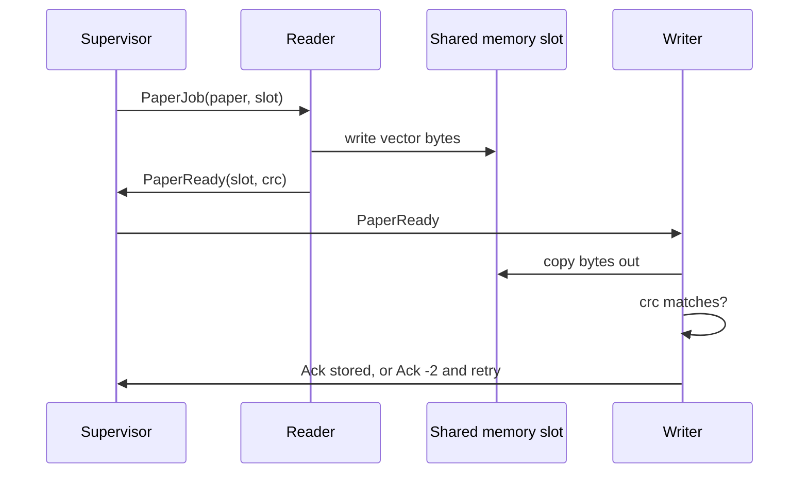

## 11. Request limiter (reserve, then sleep)

**What it does:** guarantees at most one arXiv request per 3 seconds across all threads and processes. Waiting callers do not block each other from reserving, so slots never overlap.

```text
wait():
    lock
        now = clock()
        slot = max(now, next_free)
        next_free = slot + min_interval
    unlock
    sleep until slot                  # sleeping happens OUTSIDE the lock, on purpose

penalize(seconds):                    # for Retry-After and error back-off
    next_free = max(next_free, now + seconds)
```

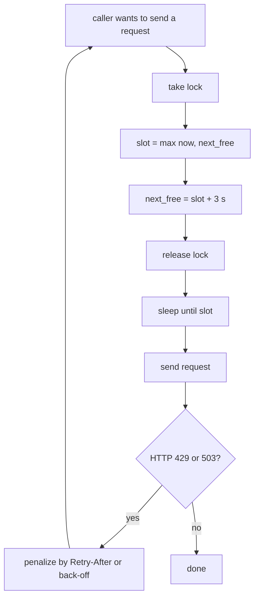

# Part C. Retrieval and ranking (E3)

## 12. 1-4 bit vector quantization (RaBitQ-style) and re-scoring

**What it does:** a paper vector has 384 numbers (1,536 bytes). We keep 1 to 4 bits per number so scanning is fast and memory is small, then re-score the best candidates with the exact half-precision copy. This is our simplified version of the RaBitQ idea; the paper's error bound is not implemented.

```text
encode (per segment):
    c = mean vector of the segment
    for each unit vector o:
        d_o = |o - c| ;  direction = (o - c) / d_o
        o' = rotate(direction) with a fixed random orthogonal matrix
        code = sign(o')                    # 1 bit; for 2-4 bits: uniform buckets of o'
        u = integer code levels ; x0 = <u/|u|, o'>
        store code, d_o, inv = 1 / (|u| * x0), oc = <o, c>

search(q, top k, pool = 2.5% of vectors (at least 100)):
    prepare q: d_q = |q - c| ; q' = rotate((q - c) / d_q)
    for each vector: est_ip = d_o * d_q * inv * <u, q'> + oc + <q, c> - |c|^2   # cheap, approximate
    pool_ids = best `pool` by est_ip
    re-score: exact_ip = <q, half-precision copy of each pool vector>          # accurate
    return best k by exact_ip
```

On your 10,400 real papers: 1-bit codes alone found 67.6% of the true top 10; after re-scoring a pool of 100, 99.7%.

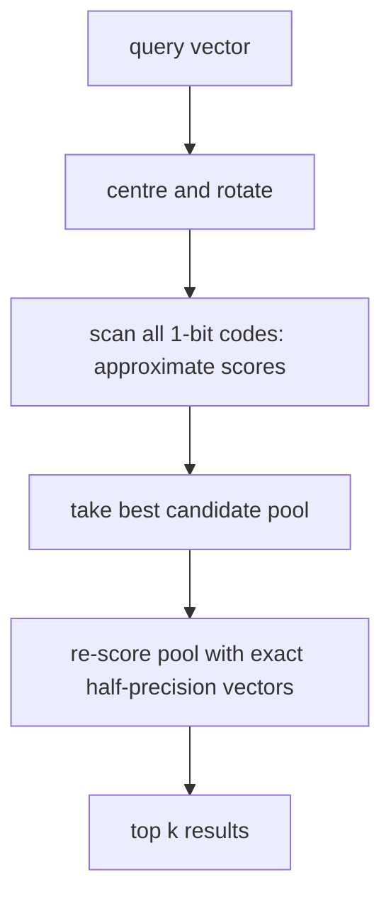

## 13. IVF clustering with k-means

**What it does:** for large segments, group similar vectors into clusters; at query time only scan the nearest few clusters instead of everything.

```text
build(vectors, nlist):
    centroids = spherical_kmeans(vectors, nlist, 10 iterations)
        repeat 10 times:
            assign each vector to its most similar centroid
            new centroid = normalised sum of its members   (re-seed an empty cluster at random)
    store centroids, and the vector ids grouped by cluster (offsets + order)

candidates(q, nprobe):
    pick the nprobe centroids with the highest <centroid, q>
    return the vector ids inside those clusters          # probing all clusters = full scan
```

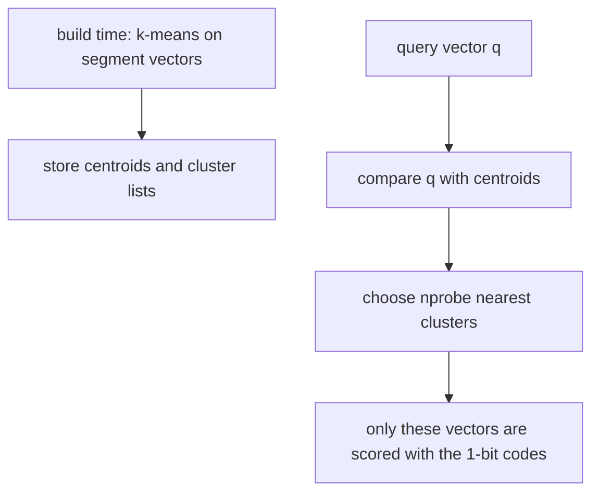

## 14. Reciprocal Rank Fusion and the hybrid query

**What it does:** BM25 scores and vector similarities are on different scales, so adding them is meaningless. RRF uses only ranks: each list gives a paper `1/(60 + rank)`; the scores are added.

```text
rrf(lists, k = 60):
    score = {}
    for each list L:
        for rank r = 1, 2, 3 ... and paper p in L:
            score[p] += 1 / (k + r)
    sort papers by score descending (ties by key)

hybrid_search(text, qvec, k):
    bm25_list   = bm25_search(text, depth)
    vector_list = vector_search(qvec, depth)       # algorithm 12, with optional IVF
    fused = rrf([bm25_list, vector_list])
    return first k, each with its rank in each list (used for the "reasons")
```

Example: rank 1 in BM25 and rank 3 in vector gives 1/61 + 1/63 = 0.0323; rank 2 in BM25 only gives 1/62 = 0.0161.

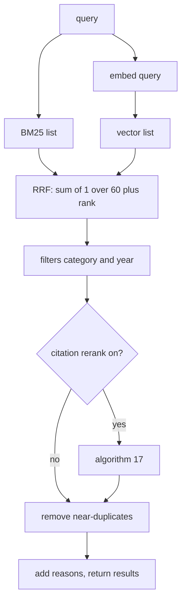

# Part D. Graph, duplicates and extras (E3)

## 15. PageRank and personalized PageRank

**What it does:** a paper is important if important papers cite it. Imagine a reader following a random citation with probability 0.85 and jumping to a random paper otherwise. PageRank is how often the reader ends up at each paper, found by repeating the update until it stops changing (power iteration). Personalized PageRank jumps back only to chosen seed papers.

```text
pagerank(graph, alpha = 0.85, tol = 1e-10, max_iter = 200, teleport = uniform):
    r = teleport
    repeat up to max_iter times:
        share[i] = r[i] / outdegree[i]  (0 for papers that cite nothing)
        spread[j] = sum of share[i] over papers i that cite j
        new = alpha * (spread + (mass of papers citing nothing) * teleport) + (1 - alpha) * teleport
        if sum |new - r| < tol: return new
        r = new

personalized_pagerank(graph, seeds): the same, but teleport = weights on the seed papers only
```

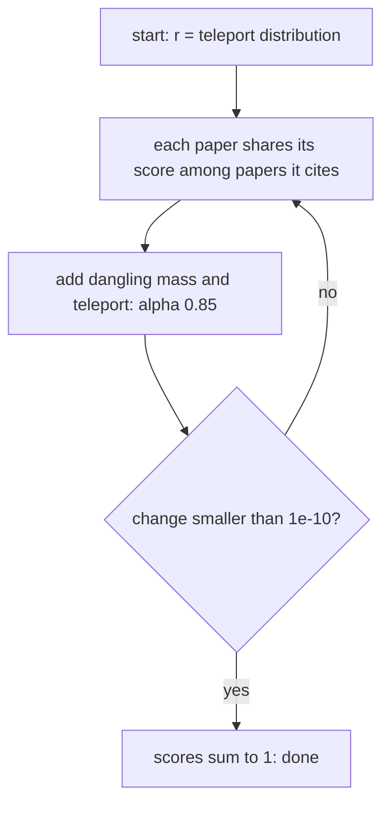

## 16. Label propagation

**What it does:** finds communities. Every paper starts with its own label and repeatedly adopts the most common label among its neighbours; papers that cite each other end up sharing a label.

```text
label_propagation(graph, max_iter = 50, seed):
    label[i] = i for every paper
    repeat up to max_iter rounds:
        changed = false
        for i in a seeded random order of papers:
            counts = labels of all neighbours of i (citing and cited)
            best = the most common label(s), ties -> smallest
            if label[i] is already among best: continue
            label[i] = smallest of best ; changed = true       # updated in place (asynchronous)
        if not changed: stop
```

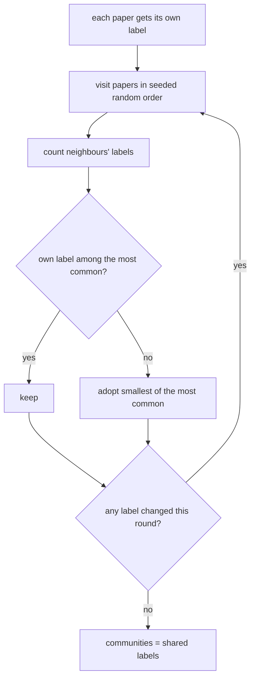

## 17. Citation-aware reranking

**What it does:** takes the top few results as seeds, runs personalized PageRank from them, and boosts candidates that sit near the seeds in the citation graph. The new ordering is merged with the old one by RRF. **Status:** built and tested, but no measured gain on real data yet, so it is off by default.

```text
citation_rerank(ranked_ids, graph, seeds = 5, weight = 1.0):
    seeds_in_graph = first 5 results that exist in the graph, weights 1, 1/2, 1/3 ...
    ppr = personalized_pagerank(undirected graph, seeds_in_graph)
    graph_rank = candidates sorted by ppr descending
    for each candidate at original rank r:
        score = 1/(60 + r)
        if candidate has a graph rank g: score += weight / (60 + g)
    sort by score
```

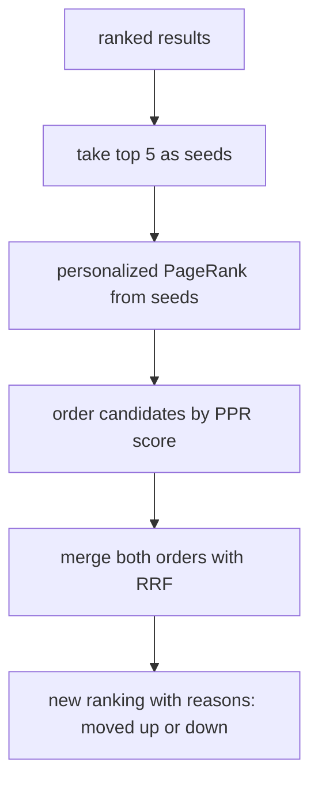

## 18. MinHash + LSH near-duplicate detection

**What it does:** finds papers that are almost copies. Comparing every pair is too slow, so each paper is squeezed into 128 numbers (MinHash); papers that match in any whole band of 8 numbers become candidates (LSH); each candidate is checked with the exact Jaccard similarity, so reported duplicates are real.

```text
shingles(text): set of hashes of every 3-word window (blake2b, so identical on every machine)
jaccard(A, B) = |A and B| / |A or B|

signature(shingles): for each of 128 hash functions h(x) = (a*x + b) mod P: take the minimum over all shingles

near_duplicate_pairs(texts, threshold = 0.8):
    for each paper: signature
    split each signature into 16 bands of 8 numbers
    put paper in bucket (band index, band values)
    for each bucket: for each pair inside: if exact_jaccard(pair) >= threshold: report it
clusters = connected groups of reported pairs (union-find, smallest key is the representative)
dedupe(ranked results): keep the best-ranked member of every cluster, drop the rest
```

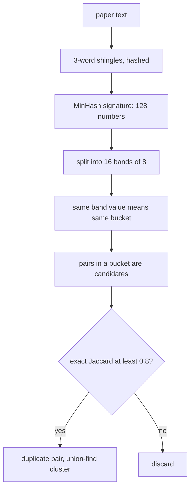

## 19. Late-interaction MaxSim rerank (stand-in encoder)

**What it does:** instead of one vector per paper, keep one small vector per word and let each query word find its best-matching paper word. **Status:** our word encoder is a stand-in (hashed letter trigrams), not ColBERT, and it has no measured gain, so it is off by default.

```text
token_vector(word) = vector built from the hashed 3-letter pieces of "#word#"   # "index" is close to "indexing"

maxsim(query, paper):
    Q = token vectors of the query words ; D = token vectors of the paper's words
    return sum over each q in Q of ( max over d in D of dot(q, d) )

rerank(top 100 candidates): sort by maxsim, descending
```

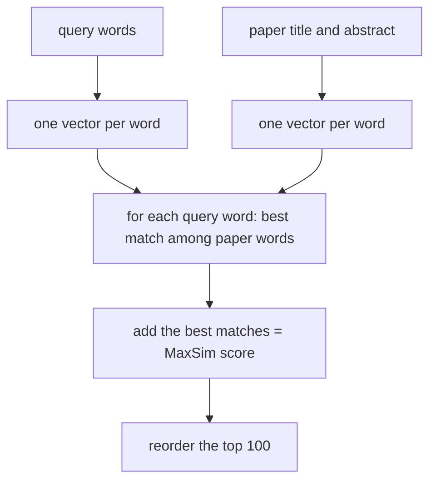

## 20. Evaluation metrics: nDCG, Recall, MRR

**What it does:** measures search quality against human relevance judgments.

```text
nDCG@10:  DCG  = sum for i = 1..10 of  rel_i / log2(i + 1)       # relevant results near the top count more
          nDCG = DCG / IDCG     where IDCG = DCG of the perfect ordering ; average over all queries
Recall@100: fraction of the relevant papers that appear in the first 100 results
MRR@10:   average over queries of 1 / (rank of the first relevant result in the top 10), or 0 if none
```

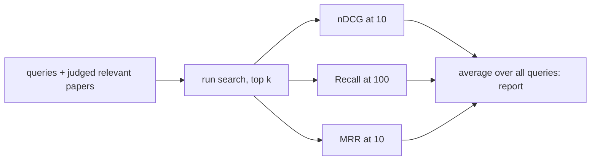

# Where to say what in the review

- **Safest to explain in detail:** algorithms 1, 2, 3 (crash safety), 6 (BM25), 12 and 14 (vectors and fusion), 9 (pipeline).
- **Say "built, tested, no measured gain yet":** 17 (citation rerank) and 19 (late interaction).
- **Always say "simplified":** 12 is RaBitQ-style, not a line-by-line port of the paper.
