# Diagrams (Phase 0)

Mermaid source. **Not rendered or checked by me** (no renderer in my sandbox): GitHub shows
them automatically; if one fails to render, tell me. Diagrams marked *planned* show design
that is not built yet. The full set for the review (engine-wise, ER of stored files, state
diagrams, query activity) is produced as each part is built.

## 1. What exists after Phase 0

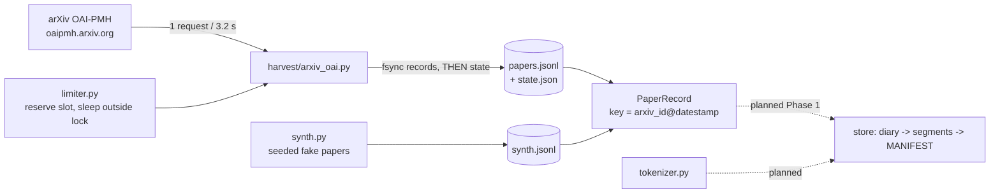

## 2. Diary record on disk (built)

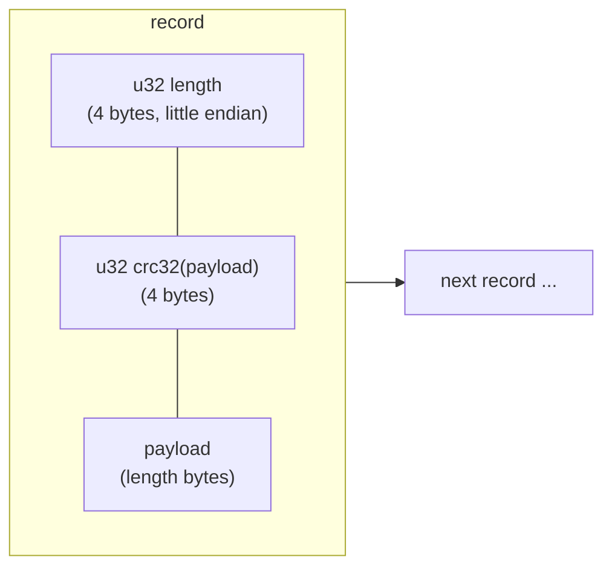

Scan rule: stop at the first record that is short, too long (> 64 MiB) or fails its CRC;
everything before it is trusted, everything from it onward is cut.

## 3. Publishing a MANIFEST (built) and a flush (planned)

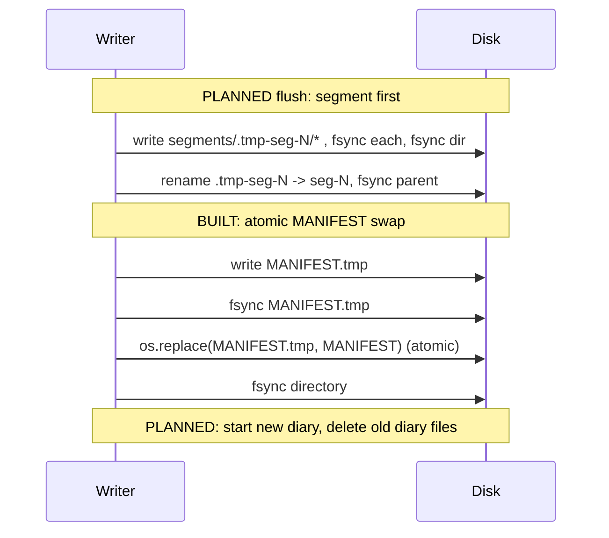

## 4. Harvester loop (built)

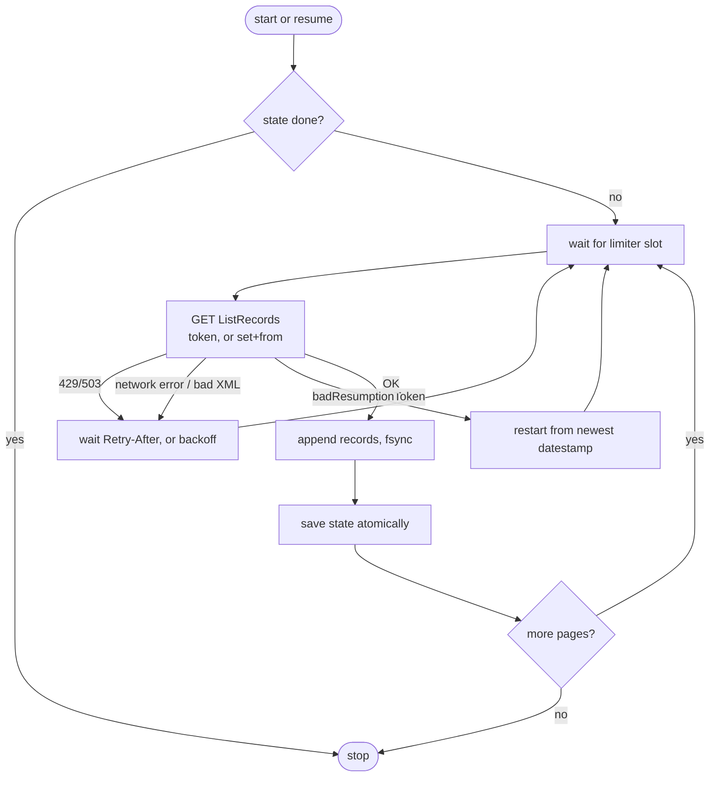

---

# Phase 1 additions (built)

Mermaid source, **not rendered by me**. If one fails to render on GitHub, tell me.

## 5. Life of a paper inside the store

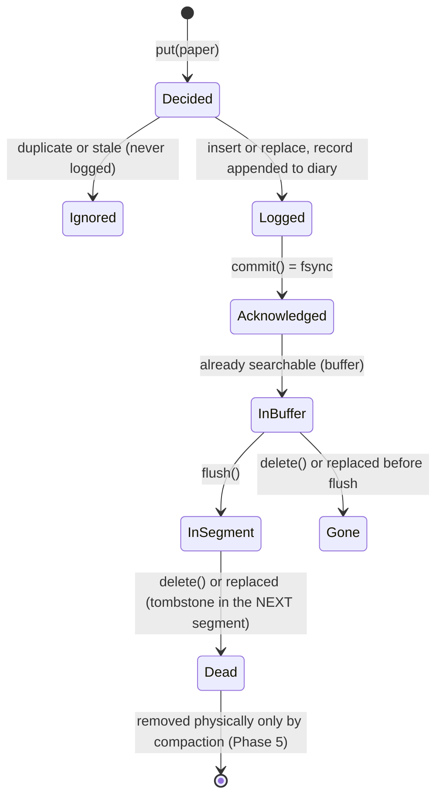

## 6. Flush and what a crash at each step leaves behind

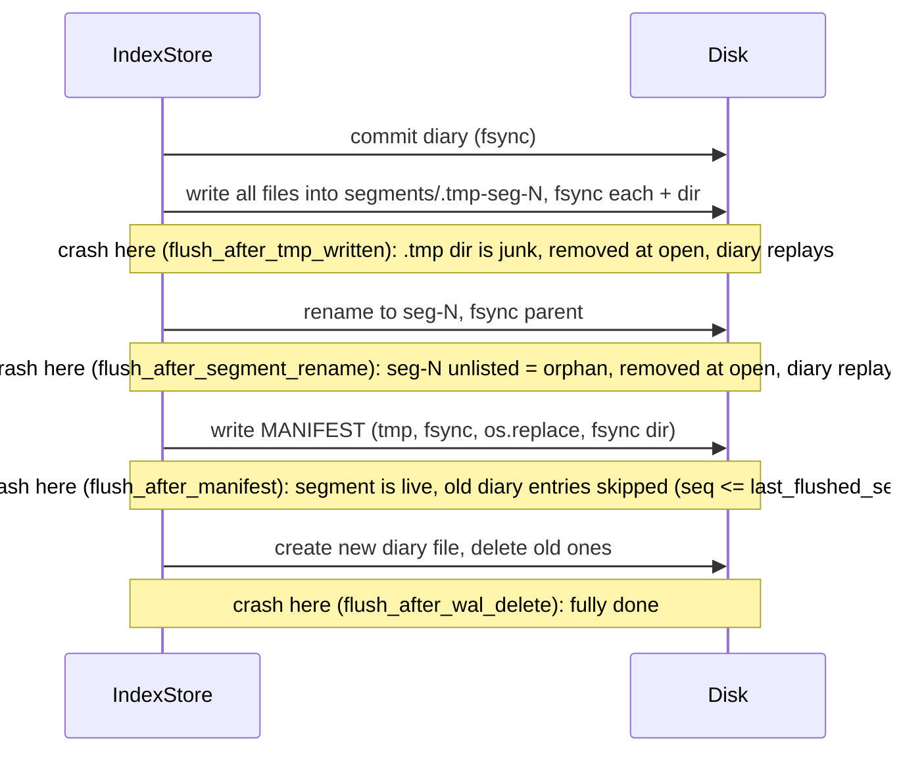

## 7. Opening an index (recovery)

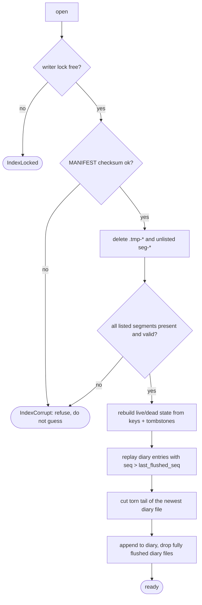

# Phase 2 additions (built)

## 8. Life of a job in the supervisor's books

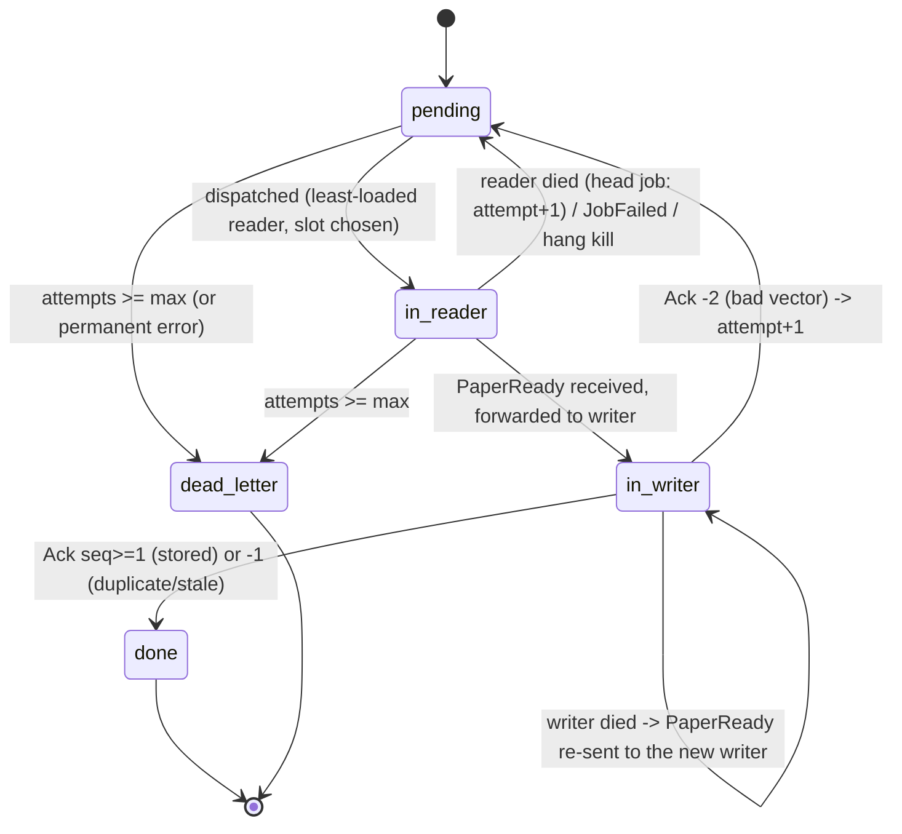

## 9. One paper through the pipeline

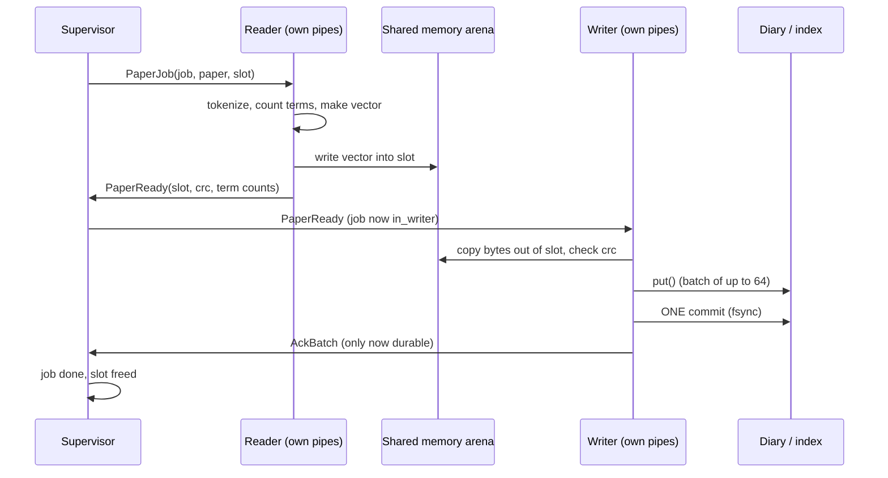

## 10. Architecture of the whole system (Phases 0-7)

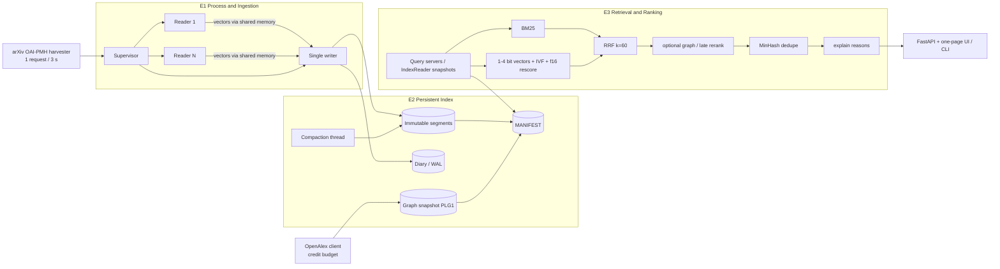

## 11. Stored files (ER view)

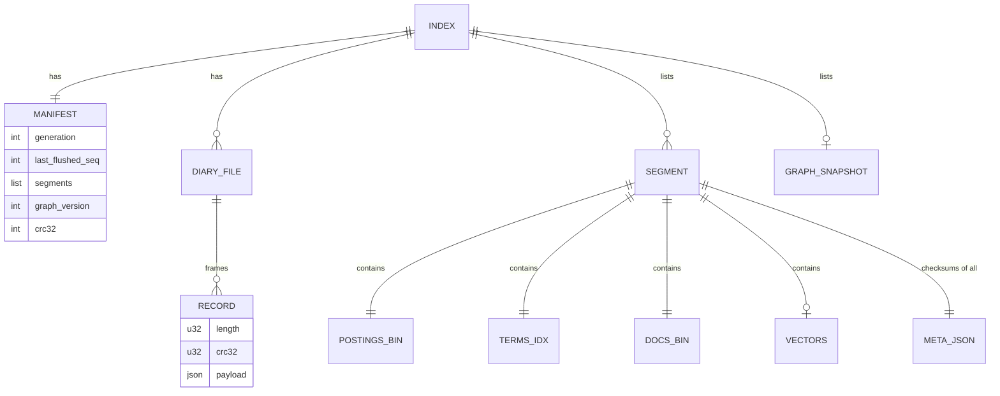

## 12. Segment life cycle

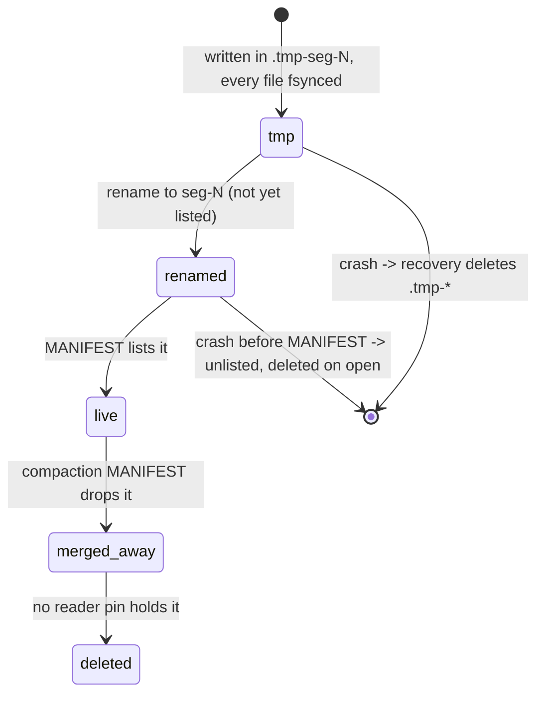

## 13. Query processing (activity)

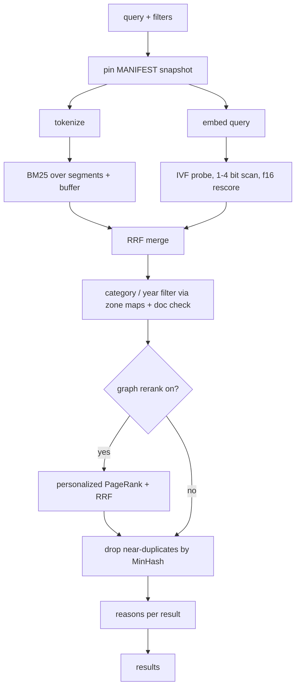
