Only standard data-structure and algorithm topics from a DSA course are listed. For each: **where we use it**, **pseudo code**, **flow chart**, and **complexity**. Files are in `src/paperlens/`.

| # | Standard algorithm / structure | Used for | File |
|---|---|---|---|
| 1 | Hash map (dictionary) | Term lookup, key to location, score accumulation | `store/segment.py`, `store/index.py` |
| 2 | Inverted index | The search structure | `store/segment.py` |
| 3 | Delta encoding + variable-byte integers | Compressing postings | `text/varint.py` |
| 4 | Heap based top-k | Best k results | `store/index.py` |
| 5 | Quickselect (partial sort) | Best clusters, per-segment k best | `vectors/ivf.py`, `store/index.py` |
| 6 | Sorting and counting sort | Ordering results, building the graph arrays | `store/index.py`, `graph/csr.py` |
| 7 | Queue (FIFO deque) | Pending jobs and in-flight jobs | `pipeline/supervisor.py` |
| 8 | Sliding window scan | Choosing which segments to merge | `store/compaction.py` |
| 9 | Graph in CSR (compressed sparse row) form | The citation graph | `graph/csr.py` |
| 10 | Union-Find (disjoint set) with path compression | Grouping near-duplicate papers | `graph/minhash.py` |
| 11 | Hashing: CRC32, universal hash, blake2b | Checksums, MinHash | `store/diary.py`, `graph/minhash.py` |
| 12 | Set operations (Jaccard similarity) | Near-duplicate check | `graph/minhash.py` |
| 13 | PageRank (power iteration) | Importance of papers | `graph/rank.py` |
| 14 | Label propagation | Communities in the citation graph | `graph/rank.py` |
| 15 | k-means clustering | IVF vector index | `vectors/ivf.py` |

# 1. Hash map (dictionary) lookup

**Use:** every segment keeps `terms`: a dictionary from a word to (offset in postings file, document frequency). Searching a word is one dictionary lookup, not a scan. Other uses: the buffer index, mapping a paper key to its segment and position, and accumulating RRF scores.

```text
build:  for each term in the terms file: terms[term] = (offset, df)
lookup(term):
    entry = terms.get(term)            # hash the string, jump to its bucket
    if entry is none: return no postings
    return entry                       # then read postings at `offset`
```

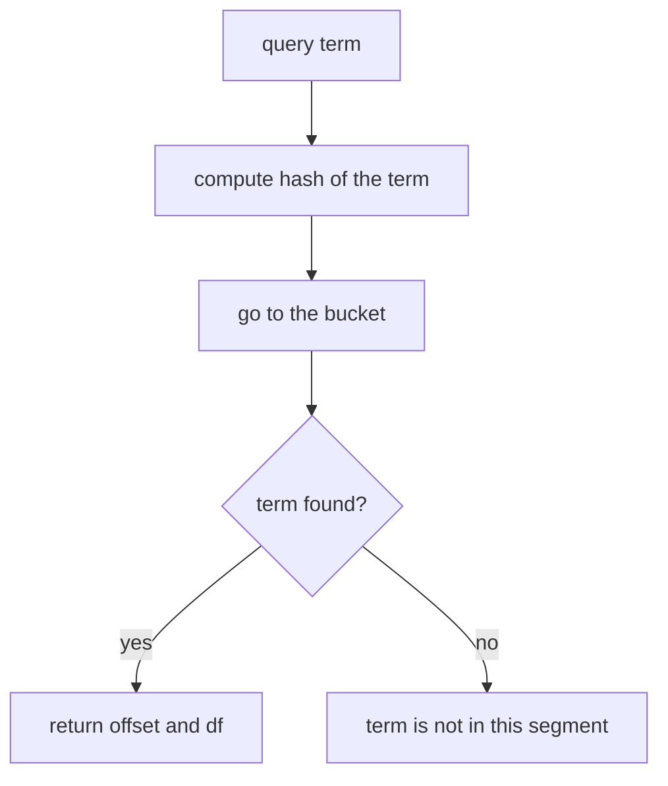

**Complexity:** O(1) average per lookup, O(number of terms) memory.

# 2. Inverted index

**Use:** instead of scanning every paper for a word, store for each word the list of papers that contain it (with the count of times, tf).

```text
build(documents):
    index = empty map
    for each document d with id i:
        for each term t and its count tf in d:
            index[t].append((i, tf))              # ids are added in increasing order
search(query):
    scores = array of 0 for every document
    for each term t in query:
        for (i, tf) in index[t]:                  # only documents that contain t
            scores[i] += BM25 part(t, tf, length of i)
    return the best k documents by score
```

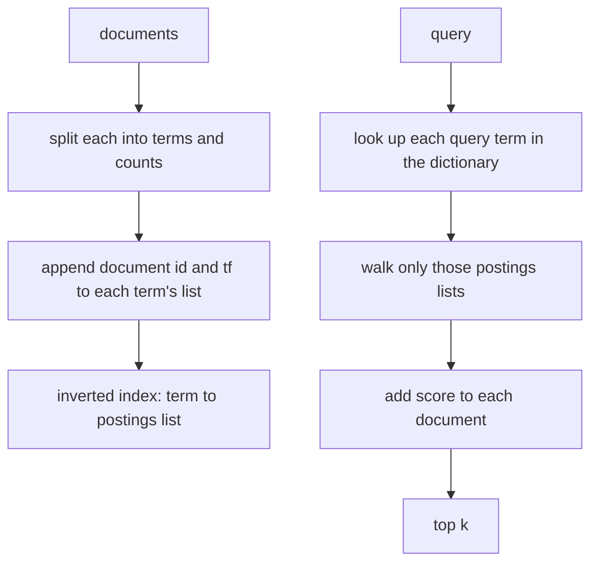

**Complexity:** a query costs O(total length of the query terms' postings lists), not O(all documents).

# 3. Delta encoding + variable-byte integers

**Use:** postings document ids are increasing, so we store the differences (gaps), which are small, and write each number in as few 7-bit groups as needed.

```text
encode(list of (doc, tf)):
    prev = -1
    for (doc, tf) in list:
        write varint(doc - prev) ; write varint(tf) ; prev = doc
varint(n):
    while n >= 128: output (n mod 128) + 128 ; n = n div 128
    output n
decode: read varints ; running sum of the gaps gives the doc ids
```

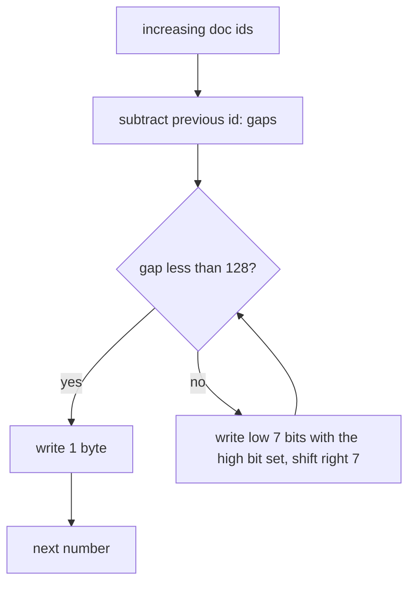

**Complexity:** O(n) to encode and decode. Example: ids 3, 7, 8, 20 become gaps 4, 4, 1, 12; every gap fits in one byte.

# 4. Heap-based top-k

**Use:** we need only the best k results (k = 10 or 100) out of thousands of scored papers. A heap of size k does this without sorting everything. Ties are broken by key, so results are deterministic.

```text
top_k(items, k):                       # best = highest score, then smallest key
    heap = empty min-heap of size at most k
    for item in items:
        if heap has fewer than k items: push item
        else if item is better than the worst item in the heap (heap top):
            replace the heap top with item (pop then push)
    return heap items sorted best first
```

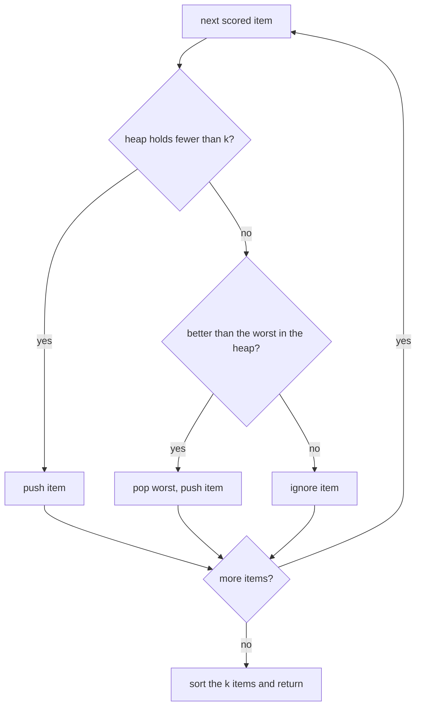

**Complexity:** O(n log k) time, O(k) memory, better than sorting all n items (O(n log n)) when k is small. In the code: `heapq.nsmallest` and `heapq.nlargest`.

# 5. Quickselect (partial selection)

**Use:** pick the nprobe best clusters, or the k-th largest score in a segment, in O(n), without a full sort. In the code: `np.argpartition` and `np.partition`.

```text
select(a, k):                          # find the k-th smallest element
    pick a pivot p
    left = elements smaller than p ; right = elements larger than p
    if k <= size of left: return select(left, k)
    else if k is inside the pivot group: return p
    else: return select(right, k - size of left - size of pivot group)
```

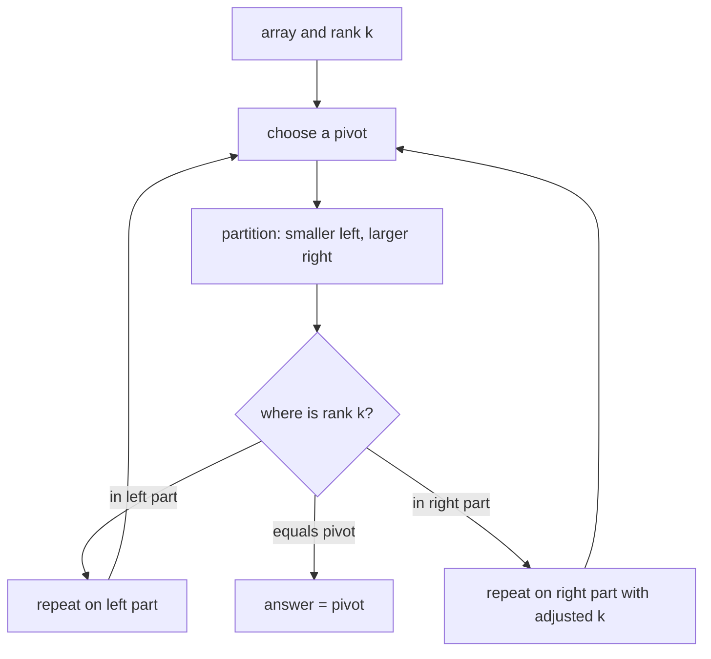

**Complexity:** O(n) average (O(n²) worst case, rare with a good pivot).

# 6. Sorting and counting sort

**Use 1:** sorted terms when writing a segment, results ordered by score, stable `argsort` that groups vectors by cluster id.
**Use 2 (counting sort):** building the citation graph arrays: count edges per node, prefix-sum the counts to get offsets.

```text
counting_sort_by_source(edges, n):       # used to build the CSR graph
    count[s] = number of edges whose source is s          # one pass
    offset[0] = 0 ; offset[s+1] = offset[s] + count[s]     # prefix sums
    place each edge target into targets[offset[s] ...]
```

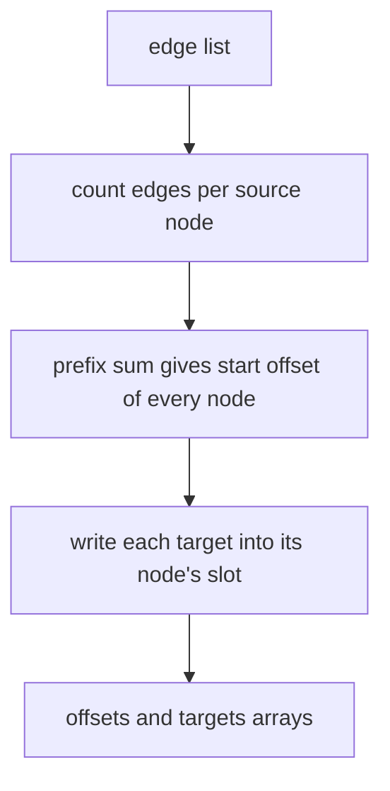

**Complexity:** comparison sorts O(n log n); counting sort O(n + number of nodes).

# 7. Queue (FIFO) with a deque

**Use:** the supervisor keeps a queue of pending jobs and, for every reader, the queue of jobs it was given in order. If a reader dies, the job at the head of its queue is the one that was running, so only that job is blamed.

```text
dispatch(job):  reader.inflight.append(job)            # enqueue at the back
on result:      job = reader.inflight.popleft()        # dequeue from the front
on reader death:
    blame = reader.inflight[0]                          # head of the queue
    move every job in reader.inflight back to the pending queue
```

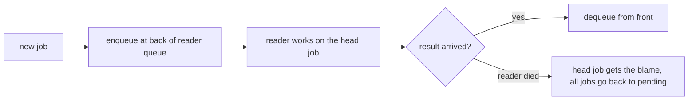

**Complexity:** enqueue and dequeue are O(1) with a deque.

# 8. Sliding window scan

**Use:** choose which neighbouring segments to merge: look at every window of 4 consecutive segments; merge the first window whose largest segment is at most 4 times its smallest.

```text
plan(sizes, fan_in = 4, ratio = 4):
    for i in 0 .. n - fan_in:
        window = sizes[i .. i + fan_in - 1]
        if max(window) <= ratio * max(1, min(window)): return (i, i + fan_in - 1)
    return nothing
```

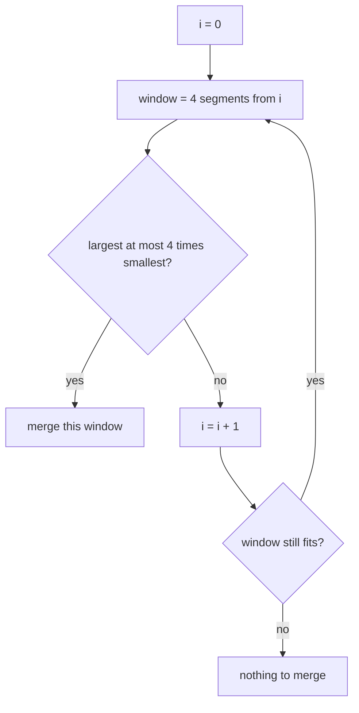

**Complexity:** O(n) windows; each window costs O(fan_in).

# 9. Graph in CSR (compressed sparse row) form

**Use:** the citation graph (paper to the papers it cites) is stored as two arrays, so listing a paper's neighbours is a slice, and the file is small and fast to load.

```text
offsets[i] .. offsets[i+1]   is the range in targets[] holding the papers cited by paper i
neighbours(i) = targets[offsets[i] : offsets[i+1]]
out_degree(i) = offsets[i+1] - offsets[i]

reverse(graph):                       # who cites paper j? (counting sort by target)
    count[j] = number of edges pointing to j
    offsets' = prefix sums of count
    for each edge (i -> j): place i into reverse_targets at j's slot
```

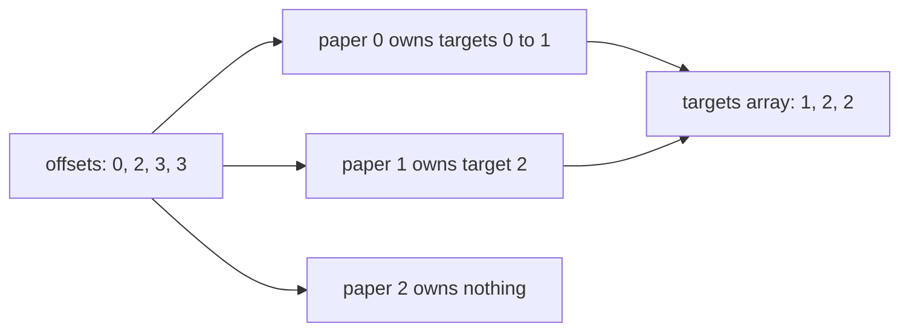

**Complexity:** neighbour access O(1) plus the number of neighbours; memory O(nodes + edges); reversing the graph O(nodes + edges).

# 10. Union-Find (disjoint set) with path compression

**Use:** near-duplicate pairs are found two at a time; Union-Find merges them into groups (clusters). The smallest key is the group's representative, so results are deterministic.

```text
find(x):
    while parent[x] != x:
        parent[x] = parent[parent[x]]        # path compression (halving)
        x = parent[x]
    return x
union(a, b):
    ra = find(a) ; rb = find(b)
    if ra != rb: parent[max(ra, rb)] = min(ra, rb)
```

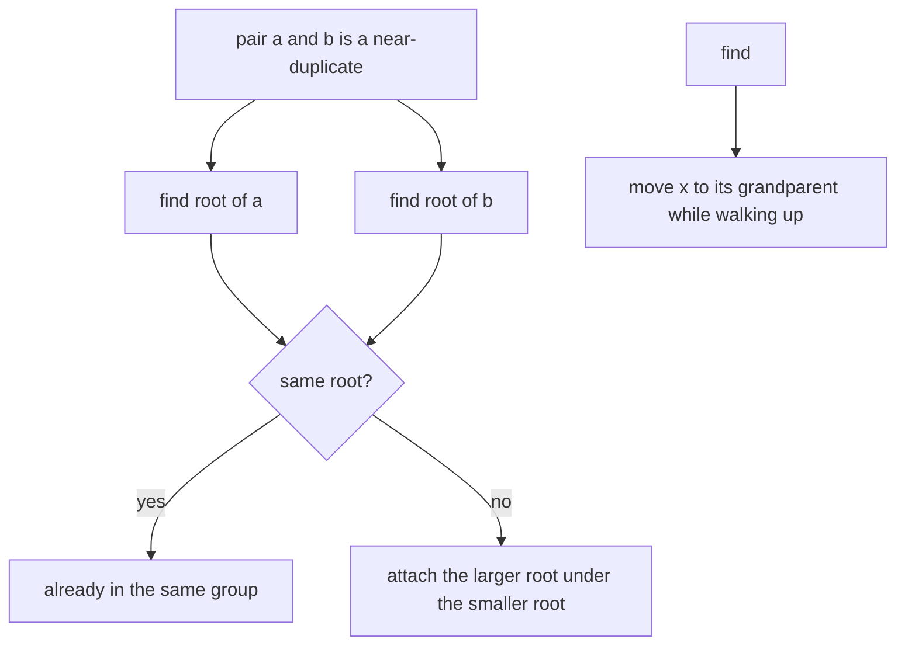

**Complexity:** almost O(1) per operation (inverse Ackermann with union by rank; ours uses path compression and smallest-key rule, which is O(log n) amortized).

# 11. Hashing: CRC32, universal hash, blake2b

**Use:**

- **CRC32** checksum on every diary record and file, to detect damage.
- **blake2b** to hash word 3-grams into numbers (the same on every machine).
- **Universal hash** `h(x) = (a * x + b) mod P` with prime P = 2^31 - 1, 128 different (a, b) pairs, for MinHash.

```text
MinHash signature of a set S of shingle numbers:
    for each of 128 hash functions (a, b):
        signature[j] = minimum over x in S of ( (a * x + b) mod P )
Two sets agree at a position with probability equal to their Jaccard similarity.
```

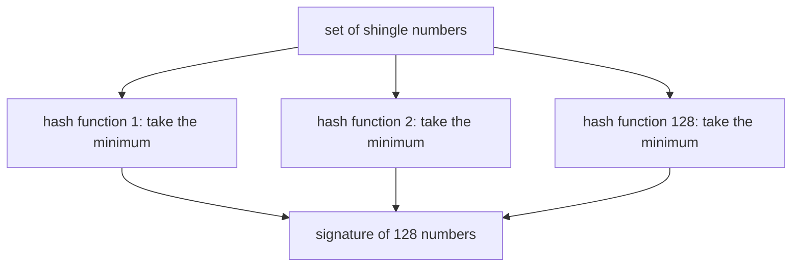

**Complexity:** O(128 x |S|) per paper.

# 12. Set operations (Jaccard similarity)

**Use:** the exact check for a candidate near-duplicate pair.

```text
jaccard(A, B) = |A intersect B| / |A union B|       # both empty -> 1
near-duplicate if jaccard >= 0.8
```

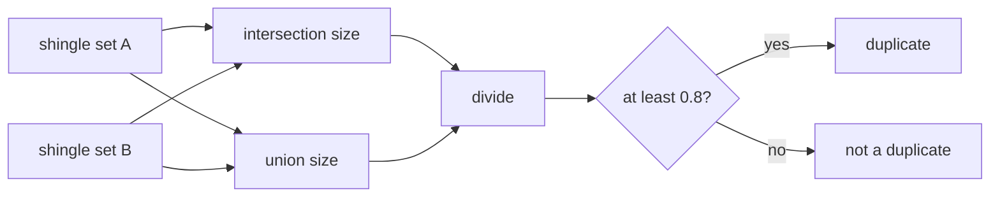

**Complexity:** O(|A| + |B|) with hash sets.

# 13. PageRank (power iteration)

**Use:** score how important each paper is from the citation graph (a paper is important if important papers cite it). Personalized PageRank restricts the random jump to chosen seed papers.

```text
r = uniform vector (1/n each)
repeat up to 200 times:
    for each paper i: share[i] = r[i] / out_degree(i)         # 0 if it cites nothing
    for each citation i -> j: spread[j] += share[i]
    new = 0.85 * (spread + dangling_mass * teleport) + 0.15 * teleport
    if sum |new - r| < 1e-10: return new
    r = new
```

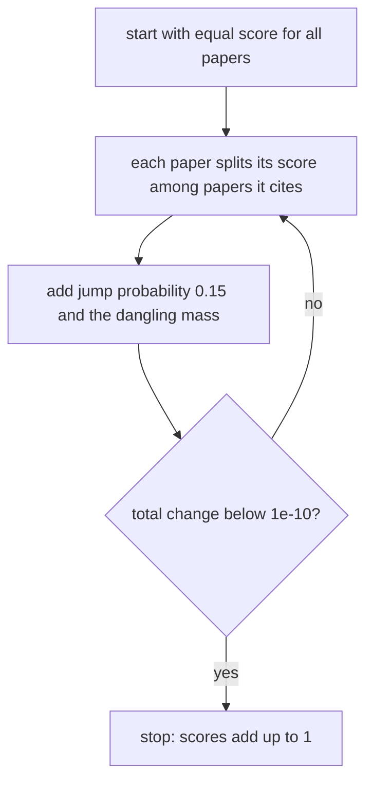

**Complexity:** O(iterations x (nodes + edges)).

# 14. Label propagation

**Use:** find communities of papers that cite each other.

```text
label[i] = i for all i
repeat up to 50 rounds:
    changed = false
    for each node i in a seeded random order:
        most_common = the most frequent label among the neighbours of i (ties: smallest)
        if label[i] is among most_common: continue
        label[i] = smallest of most_common ; changed = true
    if not changed: stop
```

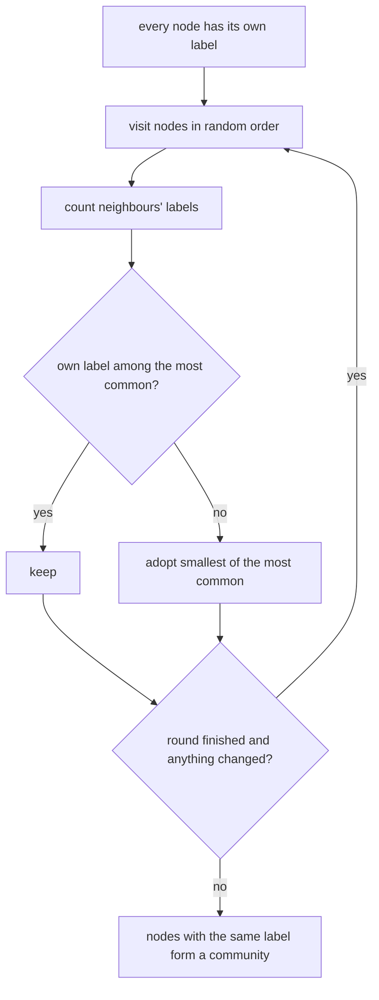

**Complexity:** O(rounds x (nodes + edges)).

# 15. k-means clustering

**Use:** group paper vectors into clusters for the IVF index; a query only scans the nearest clusters.

```text
centroids = k random vectors
repeat 10 times:
    assign every vector to its most similar centroid        # dot product (unit vectors)
    for each cluster: centroid = normalised sum of its members
                      (an empty cluster gets a random vector)
```

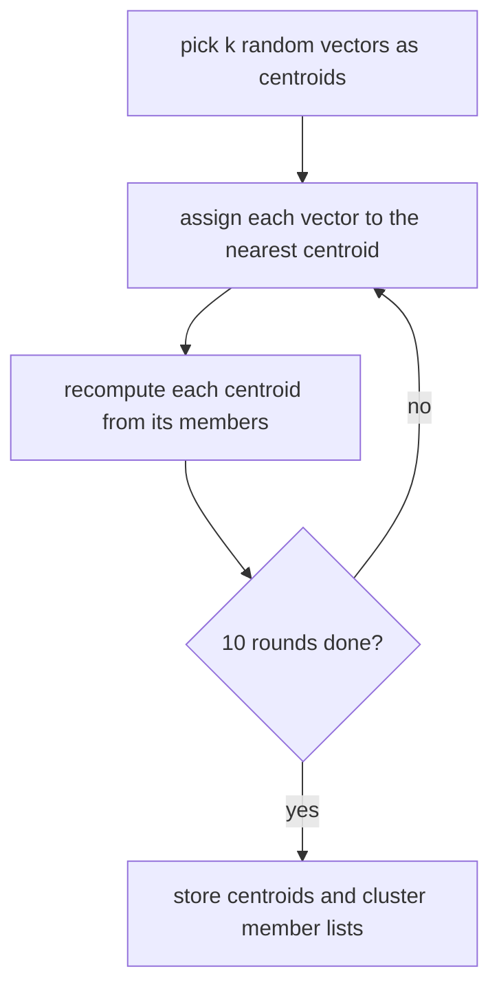

**Complexity:** O(rounds x n x k x dimension).

# What is NOT in the project

We do not use B-trees, tries, balanced binary search trees, explicit binary search, BFS or DFS, Dijkstra, or dynamic programming.
